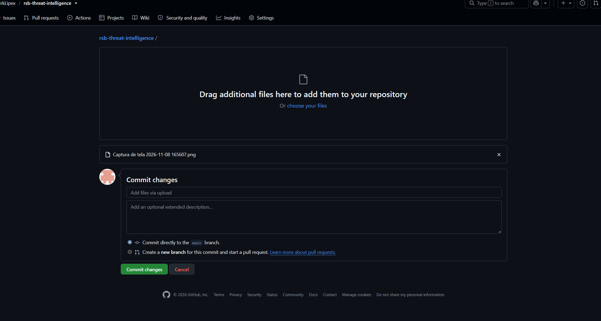

# 🦅 Raven Secure Builds (RSB) — Real-Time Threat Intelligence & WAF Engine

A lightweight, cloud-native **Web Application Firewall (WAF)** and **SIEM Interface** designed to intercept, analyze, and mitigate malicious payloads in real-time. Built entirely with pure Python infrastructure, utilizing highly optimized Regular Expressions (Regex), algorithmic rate-limiting, IP geolocation mapping, and stateful database tracking.



## ⚡ Live Architecture Demonstration


*The live environment receives external HTTP POST request streams from authorized edge clients, instantly processing security scoring models without freezing the core application pipeline.*

---

## 🔬 Core Security Features

- **Asynchronous Network Portscanning:** Multi-threaded socket scanners mapping exposure vectors dynamically.
- **Deep Packet Inspection Engine (DPI):** Active Regex matrices auditing inbound network requests to catch OWASP Top 10 vulnerabilities (SQL Injections, Cross-Site Scripting, Path Traversal, and Command Injections).
- **Algorithmic Brute-Force Mitigation:** Stateful request-tracking using double-ended queues (`collections.deque`) to log fail-rates over sliding time horizons.
- **Automated Defensive Action:** Immediate adaptive response framework supporting automated temporary firewall isolation and structural permanent bans.
- **Geographic Network Intelligence:** IP Metadata processing that resolves inbound routing vectors to target continents and countries.
- **Cryptographic Asset Auditing:** Cryptographic asset evaluation measuring key entropy and syntax resilience (up to Military-Grade evaluation tiers).
- **Data Export & Compliance Engine:** Streamlined system audit compilation directly into structural CSV tables for corporate security reviews.

---

## ⚙ System Architecture & Pipeline


- **Database Architecture:** Local stateful SQLite3 cluster database.
- **Network Interface:** Native HTTP Server Node stack.
- **Cloud Computing Platform:** Scaled and isolated public cloud environment.

---

## 🚀 Quickstart: Edge Simulation client (`rsb_agent.py`)

To demonstrate the real-time processing capabilities of the RSB engine, use the embedded edge script included in this repository to forward sample payloads to the cloud endpoint.

### 1. Installation
No third-party packages are required. The agent operates strictly with native Python libraries.

### 2. Execution Pipeline
Run the simulation script from your terminal console to trigger specific threat payloads against the cloud architecture node:

```bash
python rsb_agent.py
```

### 3. Threat Payload Test Profiles
- **Option 1:** Simulated Path Traversal Pattern (`../etc/passwd`)
- **Option 2:** Malicious SQL Injection Token (`UNION SELECT * FROM users`)
- **Option 3:** XSS Script Injection Vector (`<script>alert(1)</script>`)

---

## 🔒 Security & Privacy Notice
The production-tier server application source code, deep inspection algorithms, and database cryptographic salts are kept within a **Private Corporate Repository** to preserve intellectual property and prevent reverse-engineering of active exploit definitions.

---
*Developed by RSB Security Systems. Designed for scalable B2B architecture models.*
